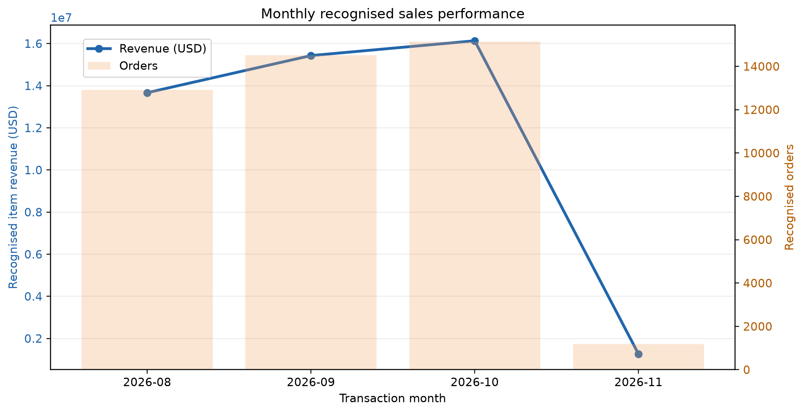
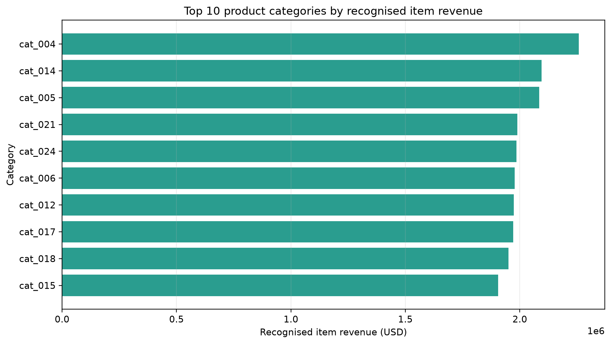
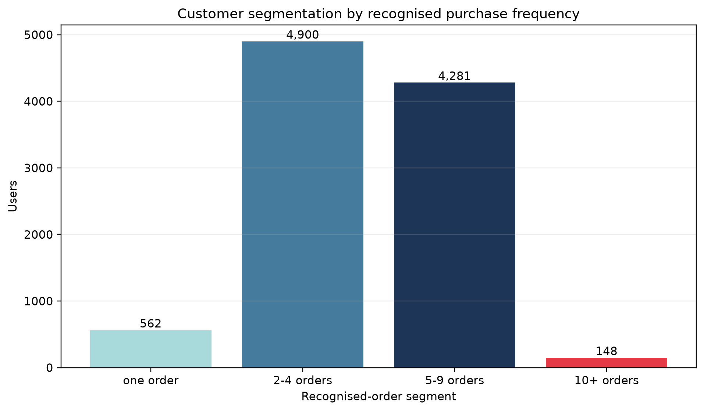
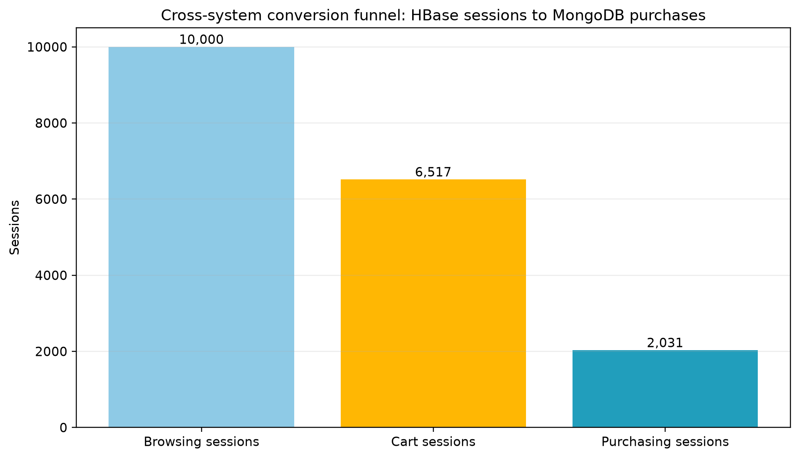

# E-Commerce Big Data Analytics Platform

## Technical Report

**Student:** _[Uwizeye Christelle]_  
**Student ID:** _[101465]_  
**Course:** Big Data Analytics  
**Submission date:** _[11th November 2026]_

---

## 1. Introduction and system architecture

This project implements an e-commerce analytics platform over a synthetic 90-day dataset containing 10,000 users, 5,000 products, 25 categories, 50,000 transactions, and 200,000 browsing sessions. The purpose is to demonstrate how NoSQL databases and Apache Spark can support different data shapes and analytical workloads.

The architecture has three complementary layers. MongoDB stores business documents: product catalog information, user profiles, and transactions with embedded line items. HBase stores session events in a time-oriented row-key layout for efficient retrieval of one user's browsing activity. Spark reads cleaned data and logical exports from these stores to perform large-scale transformations, SQL analytics, recommendation indicators, and an integrated conversion funnel.

```text
Synthetic JSON generator
        |
        +--> MongoDB: catalog, users, transactions --> aggregation pipelines
        |
        +--> HBase: time-series user sessions ------> prefix session query
        |
        +--> Spark: cleaning + SQL + integration ---> CSV/PNG/report findings
```

This separation is intentional. MongoDB fits nested documents whose fields are read together. HBase fits append-oriented and time-series session records where row-key locality is important. Spark fits joins and aggregations that require records from multiple logical systems.

## 2. Data modelling and storage decisions

### 2.1 MongoDB document model

Four MongoDB collections were loaded into database `ecommerce_analytics`.

| Collection | Main model choice | Rationale |
|---|---|---|
| `categories` | Category document with embedded subcategories | The hierarchy is small and stable, so one document returns a complete category branch. |
| `products` | Product detail, category snapshot, stock, and embedded price history | Product-specific history is bounded and belongs to the product. |
| `users` | Geographic profile plus embedded purchase summary | Frequently accessed totals and preferences can be read without recalculating all transactions. |
| `transactions` | Transaction header with embedded item documents | A purchase and its line items are created and analysed together; item snapshots preserve historical context. |

Indexes were created for product categories, user state/order count, transaction user/time, transaction time, and transaction item product/category. These support selective filtering before aggregation. The MongoDB loading operation stored all 25 categories, 5,000 products, 10,000 users, and 50,000 transactions; loading and indexing took 3.413 seconds.

Two aggregation pipelines were implemented. The first filters recognized order statuses (`completed`, `shipped`, and `delivered`), unwinds item arrays, and returns the top products by units and gross item revenue. The second groups recognized purchases by user and assigns `high_value`, `regular`, and `occasional` segments. The resulting segments were 8,896 regular users, 748 high-value users, and 247 occasional users.

### 2.2 HBase time-series model

The HBase `user_sessions` table uses this row key:

```text
user_id|ISO-8601-start_time|session_id
```

All sessions for one user are stored next to each other and are chronologically ordered because ISO-8601 timestamps sort lexicographically. A prefix scan such as `user_005955|` therefore retrieves one user's session history without scanning the complete table.

| Column family | Example fields | Purpose |
|---|---|---|
| `meta` | session ID, start/end time, duration, conversion status, referrer | Core session interpretation. |
| `device` | device type, OS, browser | Device/channel segmentation. |
| `geo` | city, state, country, IP address | Sparse geographic attributes. |
| `activity` | viewed products, page-view count, cart count, cart JSON | Variable-length browsing evidence. |

The second table, `product_daily_metrics`, uses `product_id|YYYY-MM-DD` and a `metrics` column family for future daily views, cart additions, units, and revenue. A deterministic 10,000-session subset was batch-loaded to `user_sessions` and successfully verified. The required example retrieval returned the stored session for `user_005955`.

MongoDB is preferable for nested catalog/profile/transaction documents and document aggregations. HBase is preferable for large, sparse, time-series session data accessed by user and time range. Neither store replaces the other; they support different query patterns.

## 3. Spark batch processing and SQL analytics

### 3.1 Cleaning and recommendation indicator

PySpark reads the raw multiline JSON files. User and product IDs are trimmed and deduplicated; text/numeric fields are standardized; dates are parsed to timestamps. Transaction item arrays are exploded into a typed line-item fact table. Invalid records are removed and line items are inner-joined to known products. This produced 109,863 cleaned transaction-item records, including 92,216 recognized-status item records. The cleaned datasets are stored as Parquet so later jobs do not repeatedly parse nested JSON.

The product recommendation indicator joins recognized transaction items to themselves using `transaction_id`. The rule `product_a_id < product_b_id` prevents mirrored product pairs. Spark then counts distinct transactions containing each pair. It found 68,565 unique pairs. The highest pair count was only two, which is expected from a large, mostly random synthetic product catalog. These pairs demonstrate the method but are weak evidence for a production recommendation engine.

### 3.2 Spark SQL

Spark SQL registers temporary views that represent MongoDB user/product/transaction data and HBase session/page-view data. Two complex SQL queries were implemented:

1. **Customer engagement and purchase value by state.** HBase sessions are grouped by user to calculate sampled sessions, page views, average duration, and converted sessions. MongoDB transaction items are grouped by user to calculate recognized orders and revenue. The results are left-joined to user profiles and grouped by state/value segment.
2. **Category view-to-purchase funnel.** HBase product-detail views are counted by category and joined to recognized MongoDB transaction items. Transaction sales are restricted to the same HBase session cohort so numerator and denominator remain comparable. Results showed approximately 8–10 purchases per 100 product-detail views across categories.

The batch job ran in approximately 30.535 seconds and the final Spark SQL job in approximately 31.619 seconds on the project laptop.

## 4. Integrated analytics workflow

### 4.1 Business question

**Which device type and acquisition channel create the strongest progression from browsing, through cart activity, to a recognized purchase?**

This question can guide marketing allocation and customer-experience improvements. For example, a channel with high traffic but weak conversion may need a better landing page, product page, or checkout experience.

### 4.2 Workflow and technology fit

Spark reads the same reproducible 10,000-session subset stored in HBase and the cleaned MongoDB-shaped transaction/product records. It derives browsing and cart stages from HBase session data and filters MongoDB transaction lines to recognized statuses. The transaction records are joined to the HBase cohort by `session_id` and then grouped by device type and referrer.

The use of `session_id` prevents unrelated events from being combined. The MongoDB sales side is deliberately limited to HBase sample session IDs, so the purchasing-session numerator and browsing-session denominator describe the same population. A left join preserves browsing sessions without a purchase.

The resulting cross-system funnel contains **10,000 browsing sessions**, **6,517 cart sessions**, and **2,031 matched recognized-purchase sessions**. Spark is appropriate because it performs the multi-source join and aggregation; HBase remains suitable for session retrieval and MongoDB remains suitable for flexible transaction documents.

## 5. Visualizations and findings

### 5.1 Monthly recognized sales performance



**Figure 1.** Revenue and recognized order count by transaction month. Compare the two measures together: if revenue grows faster than orders, average basket value may be increasing; if orders grow faster, the provider may be attracting more lower-value purchases.

### 5.2 Leading categories by recognized revenue



**Figure 2.** The ten categories with the most recognized item revenue. These categories are candidates for inventory monitoring and marketing focus. Revenue is not profit because product costs, refunds, delivery costs, and discounts beyond item-level values are not modelled.

### 5.3 Customer purchase-frequency segmentation



**Figure 3.** Users grouped by recognized-order frequency. This distinguishes one-time purchasers from repeat purchasers and supports retention initiatives such as re-engagement campaigns for low-frequency buyers.

### 5.4 Cross-system conversion funnel



**Figure 4.** Funnel stages calculated from HBase browsing/cart evidence and MongoDB recognized purchases. The largest drop occurs between cart activity and completed recognized purchase, which is a possible focus for checkout investigation. This is an association in synthetic data, not proof of the cause of abandonment.

## 6. Scalability and performance considerations

The local implementation used `local[2]` and eight Spark shuffle partitions, suitable for a laptop demonstration. A larger deployment would store the raw or cleaned data on distributed storage, increase executor capacity, and tune partitions based on file size and cluster cores. Partitioning session exports by date and/or user prefix would reduce HBase scan ranges. Parquet partitioning by transaction date would improve monthly trend queries through partition pruning.

Early filtering to recognized statuses reduces the data passed into joins. Deduplicating transaction/product records and restricting product pair creation to `A < B` reduces self-join output. The 10,000-session HBase subset was a deliberate laptop-memory decision. A production system would use time-bounded HBase scans, distributed connector reads, or incremental daily session aggregates.

## 7. Limitations and future work

The dataset is synthetic, with largely random baskets and behaviour; results should not be interpreted as real customer preferences or causal effects. The HBase implementation loads a representative 10,000-session subset rather than all 200,000 sessions. Spark accesses logical exports of MongoDB/HBase data rather than live connectors, which improves reproducibility but does not measure connector throughput.

Future work could load the complete session stream, add Spark connectors, create daily metrics in `product_daily_metrics`, incorporate returns/refunds and product cost to estimate profit, and train a recommendation model using more realistic behavioural signals. Stream processing could also update conversion and product metrics continuously.

## 8. Reproducibility

The repository README lists each command. Key applications are:

- `dataset_generator_runnable.py`
- `load_mongodb.py` and `mongodb_analytics.py`
- `prepare_hbase_subset.py`, `hbase_schema.rb`, `hbase_load_sessions.rb`, and `hbase_query_user_sessions.rb`
- `spark_batch_recommendations.py` and `spark_sql_analytics.py`
- `spark_integrated_funnel.py`
- `create_part4_visualizations.py`

The report evidence should additionally include terminal screenshots of MongoDB loading/pipelines, HBase schema/loading/query, Spark batch/SQL, the integrated funnel, and the generated charts.
